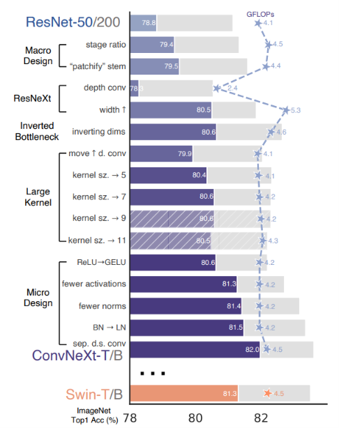
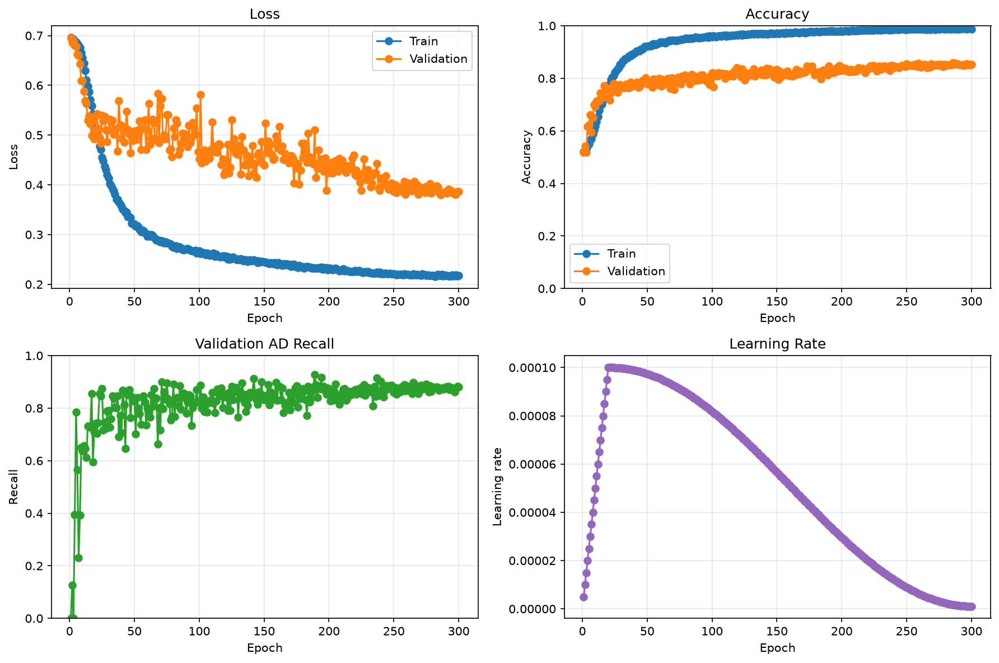
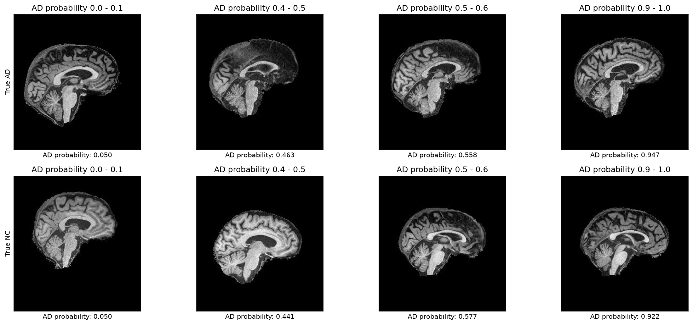
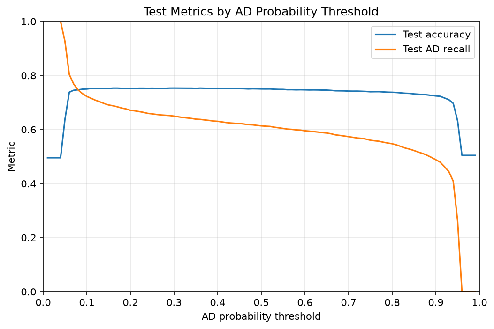
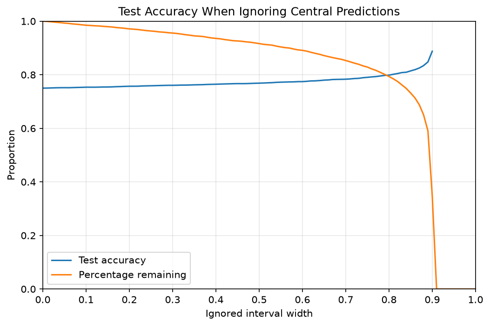

# Neuroimaging Classification for Alzheimer’s Disease using ConvNeXt
## Overview
This project aims to create and train a ConvNeXt model to classify brain MRI scans as either having Alzheimer’s Disease (AD) or being Cognitively Normal (CN). ConvNeXt is a modern convolutional neural network that is adapted from a standard ResNet architecture.

ConvNeXt expands on ResNet with redesigned blocks that use larger convolutions. This model has four stages of processing blocks, followed by a final layer that uses those features to choose between AD and CN.

The figure below shows the modifications made to a ResNet to result in the ConvNeXt architecture. A full explanation of this figure can be found in the paper listed in the References section[1].

## Feasibility Review
### User Need, Scope & Acceptance Criteria

The intended user for this model would be those in the medical field (e.g. doctors for the use of Alzheimer’s screening). The purpose of the model would be to classify brain MRI images as either Alzheimer’s Disease (AD) or Cognitively Normal (CN).

The main acceptance criteria for the model would be to obtain at least `0.8` test accuracy. Another constraint will be to limit the training runtime to `2` hours or less to avoid wait times being too long. Another important criteria would be to keep the false-negative rate to a minimum since false-negatives would correspond to someone with AD being classified as CN. For a specific threshold, false-negative rate should be kept below `0.05` (out of all the test scans with AD, at most `0.05` of them should be classified as CN).

### Model Choice & Course Concepts

The chosen model is the ConvNeXt (Hard difficulty). The reason why this kind of model would be effective is because it is based on a CNN architecture which is effective for image processing.

For dataset configuration, we can make sure we have approximately equal amounts of AD as there are CN images in both the train and test sets to avoid any class imbalance. For the test/train split, we can have `70%` for training and `30%` for testing since this is just a standard choice for the split (and because the dataset has already been configured like this on Rangpur).

### Preliminary Feasibility Evidence

The dataset has already been acquired and preprocessed so there are no issues there. The resources to be used would be the resources available on Rangpur which should be sufficient for model training.

A basic CNN classifier was made so that data loading and model training could be tested. When training this on Rangpur, data loaded successfully in a minute or less, and one epoch took `55` seconds. Based on this experiment it can be confirmed that the ConvNeXt will be able to be trained on Rangpur. `1` epoch per minute is a very rough estimate for training time, so `50`-`100` epochs should be reasonable to keep training under `2` hours.

### Risks, Budget & Fallback

The main risks for this would be training taking too long or wait times on the cluster being too long. The main way to mitigate this would just be to start training the model sooner. For computing budget, the model will be trained on Rangpur so the resources used will be whatever is available on the cluster. In terms of a fallback, if the requirements/acceptance criteria are unable to be met, then some of the criteria can be relaxed (e.g. accepting a lower test accuracy). Or if things fail, any previous models that were trained during experimentation can be used instead, even if their performance is poor or less than ideal.

## Requirements

The following Python libraries are required:

| Package | Version |
| ------- | ------- |
| `matplotlib` | `3.9.2` |
| `numpy` | `2.1.0` |
| `PIL` (Pillow) | `10.4.0` |
| `torch` (PyTorch) | `2.6.0` |
| `torchvision` | `0.21.0` |

## Usage

Run `train.py` to train a new model.

Run `predict.py` to run test results on a trained model. (update `MODEL_PATH` in `predict.py` to choose between multiple trained models)

This project has been written to run on the Rangpur computing cluster. If you are not using this, or the dataset being used is at a different directory, then update `DATA_DIR` in `dataset.py`.

## Preprocessing

The provided ADNI dataset is already split into train and test sets.
`10%` of the provided train set was put aside to be used as a validation set.
This split was done while ensuring no patient overlap between train and validation.
This validation set was used to select and save the model at the epoch that had the highest validation accuracy.

In total, the model training used the following splits:

| Split | AD | CN |
| ----- | -- | -- |
| Train | 9360 | 10000 |
| Validation | 1040 | 1120 |
| Test | 4460 | 4540 |

All images had their pixel values normalised to be between `0` and `1` (instead of `0` to `255`).

## Model architecture and training method

### Architecture
- stage depths `(3, 3, 9, 3)`
- dimensions `(96, 192, 384, 768)`
- layer-scale initialization `1e-6`
- maximum drop-path rate `0.1`

### Training
- Cross-entropy loss with label smoothing `0.1`
- AdamW optimizer
- batch size `16`
- `300` epochs
- weight decay `0.05`
- learning rate: starts at `1e-4`, warms up for `20` epochs, then follows cosine decay to `1e-6`

## Experiments

### Baseline CNN model

To get a baseline for how a standard model would perform, a basic CNN was trained.
It uses four `3x3` convolution layers with channels `1`, `32`, `64`, `128`, `256`, `2x2` max pooling after the first three layers, `4x4` adaptive average pooling, `0.5` dropout, and a final linear layer with dimensions `4096`, `2`.

Test accuracy: `73.71%`

### Training procedure

Both mixup and random augmentation were tested to see their effect on the ConvNeXt model's performance.

Mixup is a training method that blends pairs of training images and their labels which encourages the model to learn from intermediate examples which then reduces overfitting.

Random augmentation is another training method that applies varied changes to training images, which gives the model new variations of images it hasn't seen before, also reducing overfitting.

In total, four separate models were trained for this experiment and their test accuracies are recorded below:

| | No Mixup | Mixup |
| - | ------- | ----- |
| No Random Augmentation | 60.22% | 59.48% |
| Random Augmentation | 73.77% | 69.76% |

From these results we can see that including random augmentation improved model performance significantly, whereas including mixup reduced performance slightly.

Thus from here on we will include random augmentation but remove mixup for the model's training.

### Model size

The model's size was also tested to see its effect on test accuracy. The reason for testing this is because a larger model would be more complex and able to capture more information, which could lead to data memorisation and overfitting. The reverse would be true for a smaller model.

| Stage depths | Dimensions | Test Accuracy |
| ------------ | ---------- | ------------- |
| `(2, 2, 4, 2)` | `(48, 96, 192, 384)` | 72.17% |
| `(2, 2, 4, 2)` | `(96, 192, 384, 768)` | 72.74% |
| `(3, 3, 9, 3)` | `(96, 192, 384, 768)` | 73.77% |

Larger models were not tested because for the last model in the above table, the training plots indicated overfitting (plot shown in the next section).

Overall, changing the model size had little effect on results so the original size with the highest test accuracy was kept.

## Results

The best test accuracy was obtained by the model with 
that was trained with random augmentation but no mixup.

Training the model gave the following metrics:

### Model size and runtime

Model parameters: `27,818,594`
Inference latency: `4.18` ms/image on `cuda`

### Example classifications

Some examples of classifications are shown below.

With a threshold of `0.5`, everything predicted below `0.5` is classified as CN and everything above `0.5` is classified as AD. This means that in the above figure, the two top right and two bottom left images are classified correctly, and the others are incorrect.

There are four different examples of incorrect classifications in this figure. The first image shows a very confident prediction of AD as CN (false negative). The second image shows an uncertain false negative. The second last image is an uncertain false positive, and the last image is a confident false positive.

As for specific reasons for why the model failed on these cases, it is difficult to determine as a human observer (unless one were a trained professional and knew what Alzheimer's in the brain looks like).

### Threshold configuration

Since having high AD recall (i.e. low false-negative rate) is important for this scenario, we can try configuring the decision threshold so that the model has to be more confident to classify something as CN.

The plot below shows how changing the threshold affects both AD recall and overall test accuracy.

From this plot we can see that the best we can do without sacrificing too much overall test accuracy, is reduce the threshold down to around `0.06` at which point at which point AD recall goes up to `80%` while test accuracy is still above `70%`.

### Low-confidence rerouting

For a practical application of this model, we can consider routing the predictions with the least confidence to human experts. The plot below shows the effect of ignoring the central interval of predictions.

The best we can do without routing too much to a human expert would be to choose an interval width of around `0.8`. An ignored interval width of size `0.8` means that any image predicted between `0.1` and `0.9` gets routed to an expert. At this point we reach around `80%` test accuracy on the images the model predicted between `0.0` and `0.1` or between `0.9` and `1.0`. We also maintain about `80%` of the dataset which means only `20%` were predicted between `0.1` and `0.9` (so only that `20%` gets routed to a human expert).

### Proposed manager recommendation

Based on these results it can be recommended that any image predicted between `0.1` and `0.9` (accounting for `20%` of images) should be routed to an expert. This would improve the model's performance up to around `80%` test accuracy.

### Final test results

Test results for the entire test set (i.e. not ignoring anything) are shown below.

| Class | Precision | Recall | F1 | AUROC |
| ----- | --------- | ------ | -- | ----- |
| AD | 0.8390 | 0.6135 | 0.7087 | 0.8289 |
| CN | 0.6996 | 0.8844 | 0.7812 | 0.8289 |

Macro-F1: `0.7450`

**Overall test results**
| Accuracy | AD recall |
| -------- | --------- |
| 73.77% | 61.35% |

## Artificial Intelligence Usage Disclosure
Copilot - general code generation

AI-suggested code was verified by cross referencing with the paper 'A ConvNet for the 2020s' to ensure that generated code correctly implements the ConvNeXt model.

## References

[1] Z. Liu, H. Mao, C.-Y. Wu, C. Feichtenhofer, T. Darrell, and S. Xie, “A ConvNet for the 2020s,” in *Proc. CVPR*, 2022, pp. 11976–11986.